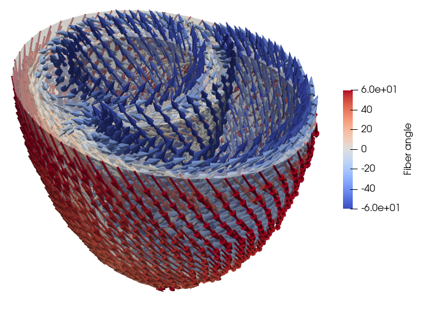
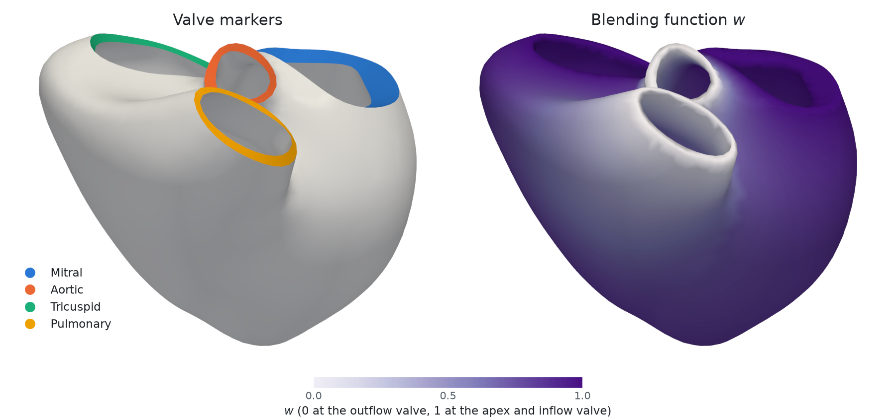
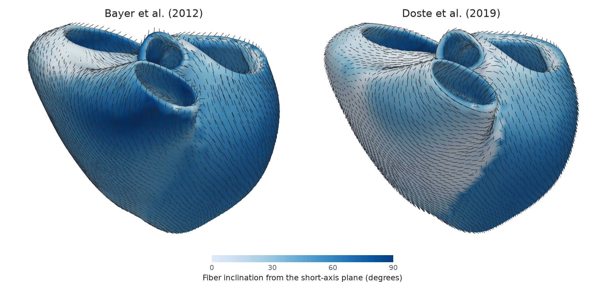

[](https://github.com/finsberg/fenicsx-ldrb/actions/workflows/docker-image.yml)
[](https://github.com/finsberg/fenicsx-ldrb/actions/workflows/pre-commit.yml)
[](https://github.com/finsberg/fenicsx-ldrb/actions/workflows/main.yml)
[](https://badge.fury.io/py/fenicsx-ldrb)

[](https://github.com/astral-sh/ruff)

# Laplace-Dirichlet Rule-Based (LDRB) algorithm for assigning myocardial fiber orientations


A software for assigning myocardial fiber orientations with Laplace-Dirichlet rule-based algorithms, based on FEniCSx. Two methods are implemented:

- `ldrb.dolfinx_ldrb`: the method of Bayer et al. (2012), for left ventricular and biventricular geometries with a single base

  > Bayer, J.D., Blake, R.C., Plank, G. and Trayanova, N.A., 2012.
  > A novel rule-based algorithm for assigning myocardial fiber orientation
  > to computational heart models. Annals of biomedical engineering, 40(10),
  > pp.2243-2254. https://doi.org/10.1007/s10439-012-0593-5

- `ldrb.dolfinx_doste`: the method of Doste et al. (2019), for biventricular geometries with outflow tracts and four valves (see [Geometries with outflow tracts](#geometries-with-outflow-tracts))

  > Doste, R., Soto-Iglesias, D., Bernardino, G., Alcaine, A., Sebastian, R., Giffard-Roisin, S.,
  > Sermesant, M., Berruezo, A., Sanchez-Quintana, D. and Camara, O., 2019.
  > A rule-based method to model myocardial fiber orientation in cardiac biventricular
  > geometries with outflow tracts. International Journal for Numerical Methods in
  > Biomedical Engineering, 35(4), e3185. https://doi.org/10.1002/cnm.3185


## Getting started
For example if you have a bi-ventricular geometry (e.g from [`cardiac-geometries`](https://github.com/ComputationalPhysiology/cardiac-geometriesx)), you can generate fibers as follows
```python
import cardiac_geometries
import ldrb
import dolfinx

# Generate an idealized BiV geometry
geo = cardiac_geometries.mesh.biv_ellipsoid(outdir=geodir)
# Generate fibers with 60/-60 fibers angles on the endo- and epicardium
system = ldrb.dolfinx_ldrb(
    mesh=geo.mesh,
    ffun=geo.ffun,
    markers=geo.markers,
    alpha_endo_lv=60,
    alpha_epi_lv=-60,
    beta_endo_lv=0,
    beta_epi_lv=0,
    fiber_space="P_2",
)
# Visualize fibers in Paraview
with dolfinx.io.VTXWriter(
    geo.mesh.comm,
    outdir / f"microstructure-viz.bp",
    [system.f0, system.s0, system.n0],
    engine="BP4",
) as vtx:
    vtx.write(0.0)
```
If you now open the file `microstructure-viz.bp` in Paraview (using the ADIOS2VTXReader), select Glyph and choose `f0` as orientation array you can see the fiber orientations similar to the following figure (here I have also added a Calculator to compute the fiber angle)


Note that you can achieve the the same results using the command line interface
```
ldrb mesh.xdmf --markers-file markers.json --fiber-space P_2 --alpha-endo-lv 60 --alpha-epi-lv -60 --beta-endo-lv 0 --beta-epi-lv 0
```
Note that if you don't specify a different angle for the RV or Septum, then the same angle as the LV will be used.

### Geometries with outflow tracts
For biventricular geometries that include the outflow tracts and the four valves, such as the [UK Biobank atlas](https://github.com/ComputationalPhysiology/ukb-atlas), you can use the rule-based method of [Doste et al. (2019)](https://doi.org/10.1002/cnm.3185). With `ldrb.dolfinx_ldrb` the four valves have to be marked together as the base, so there is one longitudinal direction from the apex to the base. `ldrb.dolfinx_doste` needs each valve as a separate marker. In each ventricle it blends the direction from the apex to the inflow valve (mitral or tricuspid) with the direction from the apex to the outflow valve (aortic or pulmonary), and it uses separate fiber angles in the LV, the RV and the outflow tracts
```python
import cardiac_geometries
import ldrb

# Mean shape of the UK Biobank atlas at end diastole
geo = cardiac_geometries.mesh.ukb(outdir="ukb", case="ED", create_fibers=False)
m = {name: value[0] for name, value in geo.markers.items()}
system = ldrb.dolfinx_doste(
    mesh=geo.mesh,
    ffun=geo.ffun,
    markers={
        "lv": m["LV_ENDO"],
        "rv": m["RV_ENDO"],
        "epi": m["EPI"],
        "mv": m["MV"],  # mitral valve
        "av": m["AV"],  # aortic valve
        "tv": m["TV"],  # tricuspid valve
        "pv": m["PV"],  # pulmonary valve
    },
    fiber_space="P_2",
)
```
The blend uses a function $w$ that is 1 at the apex and the inflow valve and 0 at the outflow valve. It is returned as `system.w_lv` and `system.w_rv`, together with the other Laplace solutions


The default angles are the ones from the paper, written in the same convention as `ldrb.dolfinx_ldrb` (see `ldrb.doste` for the details). Each of them can be changed with keyword arguments such as `alpha_endo_rv` or `beta_epi_ot`

| | $\alpha$ endo | $\alpha$ epi | $\beta$ endo | $\beta$ epi |
|---|---|---|---|---|
| LV | 60 | -60 | 20 | -20 |
| RV | 90 | -25 | 0 | -20 |
| Outflow tracts | 90 | 0 | 0 | 0 |

The figure below compares the two methods on the UK Biobank mesh, with 60/-60 degrees for `ldrb.dolfinx_ldrb`. The colour shows how far each fiber is inclined from the short-axis plane (0 is circumferential, 90 is longitudinal). Doste et al. give near-circumferential fibers on the RV epicardium and in the outflow tracts, as observed in histology


The apex of each ventricle is the point on its endocardium farthest from the inflow valve, unless you pass its coordinates with `apex_lv` and `apex_rv`. The septal interpolation of the paper is not implemented. See the [demo](https://finsberg.github.io/fenicsx-ldrb/demo_doste.html) for a full comparison of the two methods. Note that the command line interface currently only supports `ldrb.dolfinx_ldrb`.

## Installation
## pip
Note that you can install the package with `pip`, but then you need to install FEniCSx separatly, see [download](https://fenicsproject.org/download/)
```
python3 -m pip install fenicsx-ldrb
```

## conda
The package can also be installed with conda, i.e
```
conda install -c conda-forge fenicsx-ldrb
```

## Docker
To pull the latest docker image you can do
```
docker pull ghcr.io/finsberg/fenicsx-ldrb:main
```
or choose a specific version e.g
```
docker pull ghcr.io/finsberg/fenicsx-ldrb:v0.1.4
```
Note that you can also run the cli directly using docker e.g
```
docker run --rm -v $PWD:/home/shared -w /home/shared -it ghcr.io/finsberg/fenicsx-ldrb ldrb --help
```

# Documentation
See https://finsberg.github.io/fenicsx-ldrb


# License
MIT

# Contributors
Henrik Finsberg (henriknf@simula.no)
